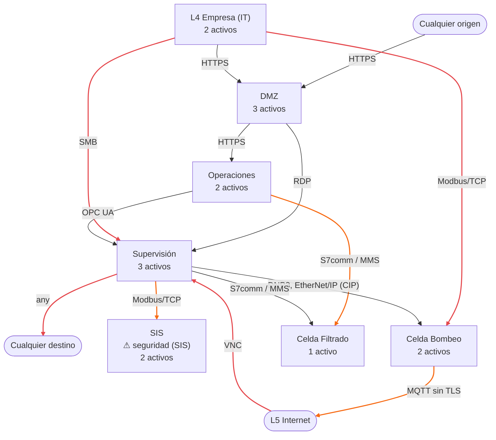

# Revisión de segmentación OT — 2026-11-23

16 activos · 7 zonas · 14 conductos con tráfico permitido · entradas: activos.csv, reglas.csv (interpretadas como reglas de firewall)

| Severidad | Hallazgos |
|---|---:|
| Critica | 4 |
| Alta | 3 |
| Media | 2 |
| Baja | 3 |

## Zonas y conductos

| Zona | Niveles | Activos |
|---|---|---|
| L4 Empresa (IT) | L4 | ERP, Oficinas |
| DMZ | L3.5 | Jump-DMZ, Hist-Mirror, VPN-GW |
| Operaciones | L3 | Historian, OT-AD |
| Supervisión | L2 | HMI-Sala, SCADA-01, EWS-Ing |
| SIS ⚠ SIS | L1, L2 | SIS-Cloro, EWS-SIS |
| Celda Bombeo | L1 | PLC-Bombas, RTU-Tanque |
| Celda Filtrado | L1 | PLC-Filtros |

| Desde | Hacia | Protocolos permitidos |
|---|---|---|
| Celda Bombeo | L5 Internet | MQTT sin TLS |
| Cualquier origen | DMZ | HTTPS |
| DMZ | Operaciones | HTTPS |
| DMZ | Supervisión | RDP |
| L4 Empresa (IT) | Celda Bombeo | Modbus/TCP |
| L4 Empresa (IT) | DMZ | HTTPS |
| L4 Empresa (IT) | Supervisión | SMB |
| L5 Internet | Supervisión | VNC |
| Operaciones | Celda Filtrado | S7comm / MMS |
| Operaciones | Supervisión | OPC UA |
| Supervisión | Celda Bombeo | DNP3, EtherNet/IP (CIP) |
| Supervisión | Celda Filtrado | S7comm / MMS |
| Supervisión | Cualquier destino | any |
| Supervisión | SIS | Modbus/TCP |

## Hallazgos

### [CRITICA] OT-01 — Acceso directo desde internet a la red OT

Internet → HMI-Sala (L2 Supervisión) por VNC. · regla R12

**Qué hacer:** Ningún flujo desde internet debe terminar en OT. El acceso remoto entra por un gateway en la DMZ industrial (L3.5) con MFA, y desde ahí a un jump host.

*Referencia: FR5 Flujo de datos restringido; zona y conducto con internet*

### [CRITICA] OT-02 — La red corporativa (IT) llega a OT sin pasar por la DMZ

ERP (L4 Empresa (IT)) → SCADA-01 (L2 Supervisión) por SMB. · regla R10

**Qué hacer:** Todo intercambio IT↔OT debe terminar en la DMZ industrial: réplica del historiador, servidor de archivos o jump host. Ninguna regla debería permitir conexiones directas de L4 a L3 o niveles inferiores.

*Referencia: FR5 Flujo de datos restringido; modelo de zonas y conductos (IEC 62443-3-2)*

### [CRITICA] OT-02 — La red corporativa (IT) llega a OT sin pasar por la DMZ

Oficinas (L4 Empresa (IT)) → PLC-Bombas (L1 Control) por Modbus/TCP. · regla R08

**Qué hacer:** Todo intercambio IT↔OT debe terminar en la DMZ industrial: réplica del historiador, servidor de archivos o jump host. Ninguna regla debería permitir conexiones directas de L4 a L3 o niveles inferiores.

*Referencia: FR5 Flujo de datos restringido; modelo de zonas y conductos (IEC 62443-3-2)*

### [CRITICA] OT-07 — Regla demasiado amplia (any) que toca OT

Regla R15: EWS-Ing → any por cualquier servicio. Llega a 10 activos de OT; alcanza al SIS (SIS-Cloro). · regla R15

**Qué hacer:** Reemplazar por reglas explícitas origen → destino → puerto, una por cada comunicación necesaria y documentada.

*Referencia: FR5 Flujo de datos restringido (lista blanca de comunicaciones)*

### [ALTA] OT-03 — Un equipo de OT inicia conexiones hacia IT o internet

PLC-Bombas (L1 Control) → Internet (L5 Internet) por MQTT sin TLS. · regla R14

**Qué hacer:** Los equipos de control no deberían salir a IT ni a internet. Los datos hacia IT se publican en la DMZ (réplica del historiador) y las actualizaciones bajan desde un servidor de parches en la DMZ.

*Referencia: FR5 Flujo de datos restringido*

### [ALTA] OT-04 — Protocolo sin autenticación entre zonas: S7comm / MMS

Historian (Operaciones) → PLC-Filtros (Celda Filtrado). · regla R09

**Qué hacer:** S7comm / MMS no autentica a quien envía comandos: cualquiera que llegue a ese puerto puede leer o escribir en el equipo. Limitar el conducto a los orígenes estrictamente necesarios. Si el firewall lo permite, inspeccionar el protocolo y bloquear las funciones de escritura y programación desde fuera de la zona. A mediano plazo, migrar a variantes seguras (OPC UA con seguridad, DNP3-SA, CIP Security).

*Referencia: FR1 Identificación y autenticación; FR5 Flujo de datos restringido*

### [ALTA] OT-05 — Acceso al sistema instrumentado de seguridad (SIS) desde fuera de su zona

SCADA-01 (Supervisión) → SIS-Cloro (SIS) por Modbus/TCP. · regla R13

**Qué hacer:** El SIS protege vidas y equipos: debe estar en una zona propia. Solo la estación de ingeniería de seguridad accede, en ventanas controladas, con la llave de modo de programación en RUN o con un mecanismo equivalente. Para monitoreo, usar lectura de una sola vía.

*Referencia: FR5 y FR3 Integridad del sistema; zona dedicada para funciones de seguridad*

### [MEDIA] OT-10 — Origen o destino que no está en el inventario

«10.10.7.44» aparece en 1 regla(s) o flujo(s) pero no coincide con ningún activo. · filas 18

**Qué hacer:** Completar el inventario: no se puede proteger lo que no se conoce. Si es un equipo retirado, eliminar la regla.

*Referencia: FR7 Disponibilidad; inventario de activos (IEC 62443-2-1)*

### [MEDIA] OT-12 — No hay una regla explícita de denegación por defecto

Ninguna regla deniega any → any al final del conjunto.

**Qué hacer:** Terminar cada conducto con una regla deny any any con registro: deja claro que solo pasa lo permitido y genera eventos para detectar intentos.

*Referencia: FR5 Flujo de datos restringido; FR6 Respuesta oportuna a eventos*

### [BAJA] OT-04 — Protocolo sin autenticación entre zonas: S7comm / MMS

HMI-Sala (Supervisión) → PLC-Filtros (Celda Filtrado). · regla R01

**Qué hacer:** S7comm / MMS no autentica a quien envía comandos: cualquiera que llegue a ese puerto puede leer o escribir en el equipo. Limitar el conducto a los orígenes estrictamente necesarios. Si el firewall lo permite, inspeccionar el protocolo y bloquear las funciones de escritura y programación desde fuera de la zona. A mediano plazo, migrar a variantes seguras (OPC UA con seguridad, DNP3-SA, CIP Security).

*Referencia: FR1 Identificación y autenticación; FR5 Flujo de datos restringido*

### [BAJA] OT-04 — Protocolo sin autenticación entre zonas: EtherNet/IP (CIP)

SCADA-01 (Supervisión) → PLC-Bombas (Celda Bombeo). · regla R02

**Qué hacer:** EtherNet/IP (CIP) no autentica a quien envía comandos: cualquiera que llegue a ese puerto puede leer o escribir en el equipo. Limitar el conducto a los orígenes estrictamente necesarios. Si el firewall lo permite, inspeccionar el protocolo y bloquear las funciones de escritura y programación desde fuera de la zona. A mediano plazo, migrar a variantes seguras (OPC UA con seguridad, DNP3-SA, CIP Security).

*Referencia: FR1 Identificación y autenticación; FR5 Flujo de datos restringido*

### [BAJA] OT-04 — Protocolo sin autenticación entre zonas: DNP3

SCADA-01 (Supervisión) → RTU-Tanque (Celda Bombeo). · regla R03

**Qué hacer:** DNP3 no autentica a quien envía comandos: cualquiera que llegue a ese puerto puede leer o escribir en el equipo. Limitar el conducto a los orígenes estrictamente necesarios. Si el firewall lo permite, inspeccionar el protocolo y bloquear las funciones de escritura y programación desde fuera de la zona. A mediano plazo, migrar a variantes seguras (OPC UA con seguridad, DNP3-SA, CIP Security).

*Referencia: FR1 Identificación y autenticación; FR5 Flujo de datos restringido*

---
Revisión documental: se basa solo en el inventario y las reglas o flujos provistos. No reemplaza una evaluación de riesgos IEC 62443-3-2 ni la validación en sitio, y nunca debe complementarse con escaneos activos sobre equipos en producción.
